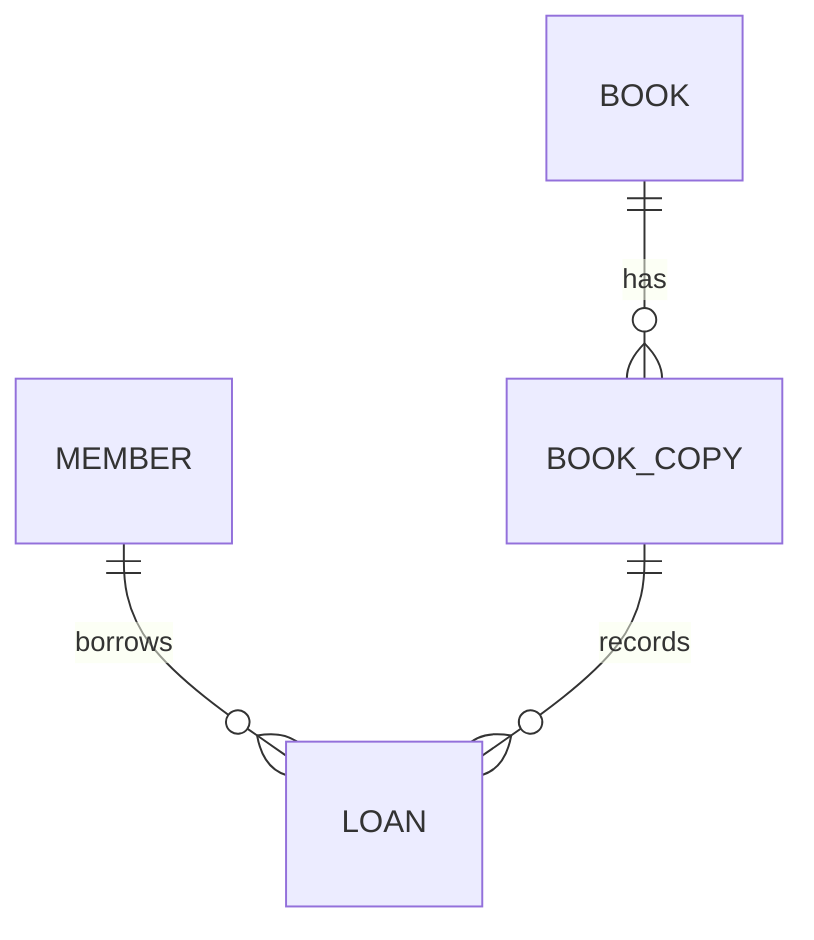

# Entity Model

APP_USER (id, username, password_hash, role, created_at) ships with the starter and is an external boundary.
This draft follows [the architecture](architecture.md) and [requirements](requirements.md).
The model's text-field defaults and loan representation remain visible in [open questions](open_questions.md).

## Entity Relationship Diagram

### BOOK

A Book is a catalog entry describing a title in the library's collection.

| Attribute | Description | Data Type | Length/Precision | Validation Rules |
| --- | --- | --- | --- | --- |
| id | Internal Book identity. | Long | 19 | Primary Key, Sequence |
| title | The title shown in the Catalog. | String | 255 | Not Null |

### BOOK_COPY

A Book copy is an individual lendable copy of a Book.

| Attribute | Description | Data Type | Length/Precision | Validation Rules |
| --- | --- | --- | --- | --- |
| id | Internal book copy identity. | Long | 19 | Primary Key, Sequence |
| book_id | The Book this book copy belongs to. | Long | 19 | Not Null, Foreign Key (BOOK.id) |
| inventory_code | The library's distinct label for the book copy. | String | 50 | Not Null, Unique |

### MEMBER

A Member profile identifies the Member who holds a Loan.

| Attribute | Description | Data Type | Length/Precision | Validation Rules |
| --- | --- | --- | --- | --- |
| id | Internal member profile identity. | Long | 19 | Primary Key, Sequence |
| user_id | The starter user account belonging to this Member. | Long | 19 | Not Null, Unique, Foreign Key (APP_USER.id) |
| name | The Member's display name. | String | 255 | Not Null |
| email | An optional contact address. | String | 255 | Optional, Format: Email |

### LOAN

A Loan records borrowing and the later return of a book copy by a Member.

| Attribute | Description | Data Type | Length/Precision | Validation Rules |
| --- | --- | --- | --- | --- |
| id | Internal Loan identity. | Long | 19 | Primary Key, Sequence |
| member_id | The Member who borrowed the book copy. | Long | 19 | Not Null, Foreign Key (MEMBER.id) |
| book_copy_id | The borrowed book copy. | Long | 19 | Not Null, Foreign Key (BOOK_COPY.id) |
| borrowed_at | Time borrowing was recorded. | DateTime | - | Not Null |
| returned_at | Time return was recorded; absent for an Active loan. | DateTime | - | Optional |

#### Constraints

- returned_at, when present, is not before borrowed_at.
