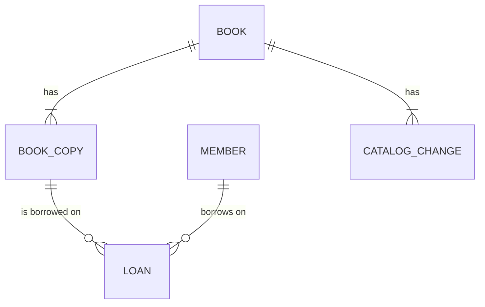

# Entity Model

APP_USER (id, username, password_hash, role, created_at) ships with the project and is an external boundary.

## Entity Relationship Diagram

### BOOK

A Book is a bibliographic record that groups its lendable Book Copies.

| Attribute | Description | Data Type | Length/Precision | Validation Rules |
| --- | --- | --- | --- | --- |
| id | Book identifier | Long | 19 | Primary Key, Sequence |
| title | Book title | String | 255 | Not Null |
| author | Author credit | String | 255 | Not Null |
| isbn | ISBN when known | String | 50 | Optional, Unique |
| withdrawn_at | Date and time the Book was withdrawn from the Catalog | DateTime | - | Optional |

#### Constraints

- Keep the Book and its Book Copies when withdrawing it so existing Loans remain traceable.
- A withdrawn Book cannot have a new Loan opened for any of its Book Copies. Existing Active Loans can still be completed.

### BOOK_COPY

A Book Copy is an individual lendable instance of a Book.

| Attribute | Description | Data Type | Length/Precision | Validation Rules |
| --- | --- | --- | --- | --- |
| id | Book Copy identifier | Long | 19 | Primary Key, Sequence |
| book_id | Book this copy belongs to | Long | 19 | Not Null, Foreign Key (BOOK.id) |

#### Constraints

- Each Book has at least one Book Copy.
- A Book Copy is available when its Book is offered in the Catalog and the copy has no Active Loan.
- Keep a Book Copy associated with its original Book so its Loans remain traceable.

### MEMBER

A Member is an enrolled person whose profile is linked to their Member Account.

| Attribute | Description | Data Type | Length/Precision | Validation Rules |
| --- | --- | --- | --- | --- |
| id | Member identifier | Long | 19 | Primary Key, Sequence |
| user_id | User Account for this Member | Long | 19 | Not Null, Unique, Foreign Key (APP_USER.id) |
| name | Member name | String | 255 | Not Null |
| email | Member email address | String | 255 | Optional, Format: Email |
| created_by_user_id | Librarian User Account that created the Member Account | Long | 19 | Not Null, Foreign Key (APP_USER.id) |

#### Constraints

- The User Account referenced by user_id has role MEMBER.
- The User Account referenced by created_by_user_id has role LIBRARIAN.
- Keep the Member and its User Account association while Loans reference the Member.

### LOAN

A Loan records a Member borrowing and returning a particular Book Copy.

| Attribute | Description | Data Type | Length/Precision | Validation Rules |
| --- | --- | --- | --- | --- |
| id | Loan identifier | Long | 19 | Primary Key, Sequence |
| book_copy_id | Borrowed Book Copy | Long | 19 | Not Null, Foreign Key (BOOK_COPY.id) |
| member_id | Member who borrowed the Book Copy | Long | 19 | Not Null, Foreign Key (MEMBER.id) |
| borrowed_at | Date and time of borrowing | DateTime | - | Not Null |
| returned_at | Date and time of return | DateTime | - | Optional |

#### Constraints

- A Loan is active while returned_at is empty.
- Each Book Copy can have at most one Active Loan.
- When present, returned_at must be at or after borrowed_at.
- The Borrow and Return actions are attributable to the User Account linked to the borrowing Member.
- Keep completed Loans and their Member, Book Copy, and timing references in Loan History.

### CATALOG_CHANGE

A Catalog Change records the Librarian User Account responsible for an addition, edit, or withdrawal of a Book.

| Attribute | Description | Data Type | Length/Precision | Validation Rules |
| --- | --- | --- | --- | --- |
| id | Catalog Change identifier | Long | 19 | Primary Key, Sequence |
| book_id | Book affected by the Catalog change | Long | 19 | Not Null, Foreign Key (BOOK.id) |
| user_id | Librarian User Account that made the change | Long | 19 | Not Null, Foreign Key (APP_USER.id) |
| action | Kind of Catalog change | String | 50 | Not Null, Values: Add, Edit, Withdraw |
| changed_at | Date and time of the Catalog change | DateTime | - | Not Null |

#### Constraints

- The User Account referenced by user_id has role LIBRARIAN.
- Record one Catalog Change for each addition, edit, or withdrawal of a Book.
