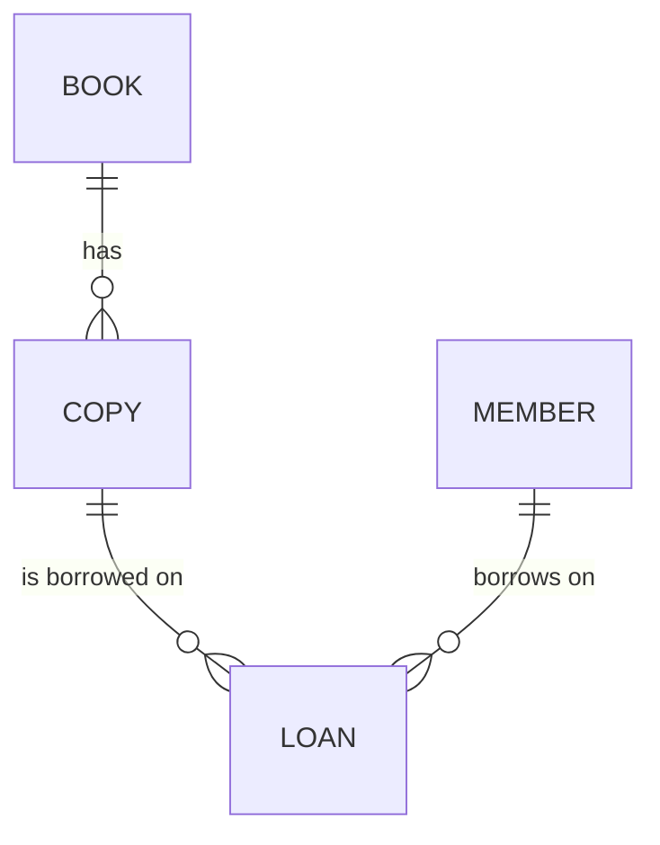

# Entity Model

APP_USER (id, username, password_hash, role, created_at) ships with the project and is an external boundary.

## Entity Relationship Diagram

### BOOK

A Book is a Catalog entry that describes the work represented by its Copies.

| Attribute | Description | Data Type | Length/Precision | Validation Rules |
| --- | --- | --- | --- | --- |
| id | Book identifier | Long | 19 | Primary Key, Sequence |
| title | Title displayed in the Catalog | String | 255 | Not Null |
| author | Author name or credit displayed in the Catalog | String | 255 | Not Null |
| isbn | ISBN identifying the edition, when available | String | 13 | Optional, Unique |

#### Constraints

- When supplied, store a valid ISBN-13 without separators, converting a valid ISBN-10 to ISBN-13.

### COPY

A Copy is a lendable instance of a Book.

| Attribute | Description | Data Type | Length/Precision | Validation Rules |
| --- | --- | --- | --- | --- |
| id | Copy identifier | Long | 19 | Primary Key, Sequence |
| book_id | Book represented by the Copy | Long | 19 | Not Null, Foreign Key (BOOK.id) |

### MEMBER

A Member Profile links a Member's User Account to the Member's Loans.

| Attribute | Description | Data Type | Length/Precision | Validation Rules |
| --- | --- | --- | --- | --- |
| id | Member Profile identifier | Long | 19 | Primary Key, Sequence |
| user_id | Member's User Account | Long | 19 | Not Null, Unique, Foreign Key (APP_USER.id) |
| name | Member's name | String | 255 | Not Null |
| email | Member's contact email when available | String | 254 | Optional, Format: Email |

#### Constraints

- Each Member Profile links to a User Account with role `MEMBER`.
- When a Librarian creates a Member's User Account, create its Member Profile in the same transaction.

### LOAN

A Loan records a Member borrowing a Copy and tracks its return.

| Attribute | Description | Data Type | Length/Precision | Validation Rules |
| --- | --- | --- | --- | --- |
| id | Loan identifier | Long | 19 | Primary Key, Sequence |
| member_id | Member Profile of the borrower | Long | 19 | Not Null, Foreign Key (MEMBER.id) |
| copy_id | Copy borrowed by the Member | Long | 19 | Not Null, Foreign Key (COPY.id) |
| borrowed_at | Date and time the Loan began | DateTime | - | Not Null |
| returned_at | Date and time the Copy was returned | DateTime | - | Optional |

#### Constraints

- A Loan is active while `returned_at` is empty.
- When recorded, `returned_at` must be at or after `borrowed_at`.
- Each Copy can have at most one Active Loan.
- Catalog changes must preserve Loan History and its links to the borrowed Copy, Book, and Member Profile.
